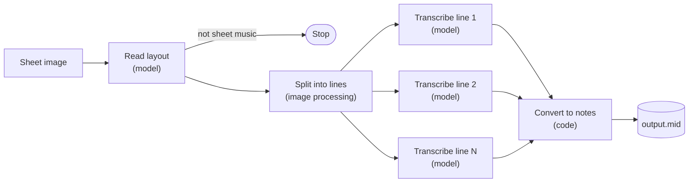
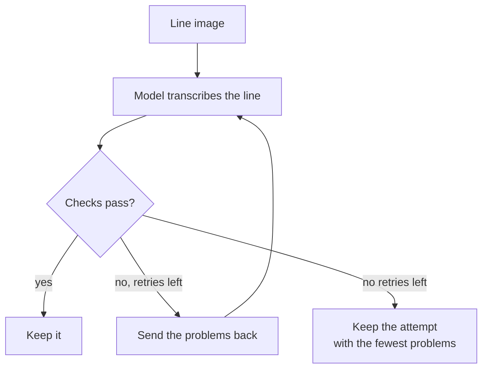

# midi-maker

Turns a photo or scan of printed sheet music into a MIDI file.

midi-maker is a [LangGraph](https://github.com/langchain-ai/langgraph) pipeline built around OpenAI vision models. It is experimental. Expect wrong notes, especially on small or blurry images.

## How it works



1. **Read layout:** a small model looks at the whole page and reports the tempo, the time signature, and the staves of each line, with their clefs and instruments.
2. **Split into lines:** image processing finds the staff lines, crops out each line (system), enlarges it, and counts its bars from the barlines. If the page can't be split, the whole page is read in one pass.
3. **Transcribe lines:** a larger model reads every line in parallel, bar by bar.
4. **Convert to notes:** code turns the transcription into timed notes and writes `output.mid`.

### Each line is checked and re-read



The checks need no image. They catch bars whose notes and rests don't add up to the time signature, the wrong number of staves in a bar, and bar counts that disagree with the barlines found in the image.

### The model reads, code computes

The model only reports what is printed on the page. Everything that takes music theory or arithmetic is done in code:

| The model reports | Code works out |
| --- | --- |
| Each notehead's staff position (letter and octave) and any accidental printed in front of it | The sounding pitch, from the key signature and the accidentals that carry through the bar |
| Note values, dots, tuplet numbers | Exact durations and start times |
| Ties, repeat signs, 1st/2nd endings | Tied notes joined, repeats played out in order |
| Dynamics, octave lines (8va, 8vb) | Note velocity, octave shifts |

## Setup and usage

You need Python 3.10 or newer, a Unix shell, and an OpenAI API key.

```sh
cp .env.example .env          # then put your OPENAI_API_KEY in .env
./generate-midi.sh path/to/sheet.png
```

- **First run:** the script creates `.venv` and installs `requirements.txt`.
- **Output:** each run writes `output.mid` and a diagram of the pipeline, `graph.png`, to the current directory.
- **Run time:** a full run usually takes several minutes, and progress is logged as each line finishes.
- **Pages:** each run reads one image, so a multi-page piece needs one run per page.

### Configuration

Set these environment variables in `.env` or in your shell:

| Variable | Default | What it does |
| --- | --- | --- |
| `MIDI_AGENT_MODEL` | `gpt-6.1-terra` | Model that transcribes the lines |
| `MIDI_AGENT_MODEL_CHEAP` | `gpt-5-nano` | Model that reads the page layout |
| `MIDI_AGENT_REASONING_EFFORT` | `high` | More effort means fewer misread notes, but slower and more expensive runs |
| `MIDI_AGENT_MAX_RETRIES` | `2` | How many times a line that fails the checks is re-read |
| `MIDI_AGENT_VERIFY` | `0` | Set to `1` to add a proofreading pass per line (one extra model call each) |
| `MIDI_AGENT_DEBUG_DIR` | unset | Saves the line images and every transcription attempt to this directory |

## What it can read

- **Supported:** treble, bass, alto and tenor clefs; key and time signature changes; accidentals; ties; tuplets; dotted notes; up to two voices per staff; repeats and 1st/2nd endings; dynamics; octave lines; up to 15 staves per line.
- **Not supported:** drum notation (it plays as pitched notes), grace notes, D.C./D.S./coda jumps, tempo changes within the piece, articulations and ornaments.
- **Image quality:** clean scans with large staves work best. On small, low-resolution images (around 500 px wide), the model often misreads pitches even when it gets the rhythm and bar structure right.

## Project layout

```
generate-midi.sh     Entry point: sets up .venv and runs the pipeline
src/agent/
  graph.py           The pipeline steps and how they connect
  imaging.py         Staff detection, line splitting, barline counting
  notation.py        Transcription checks, and conversion to timed notes
  prompts.py         Instructions given to the models
  models/            Data schemas: what the model returns, and the final score
  tools/tools.py     MIDI file writer
python-midi/         Bundled copy of the python-midi library
```

## Credits

MIDI files are written with a bundled copy of [python-midi](https://github.com/vishnubob/python-midi) by Giles Hall, released under the MIT license (see `python-midi/LICENSE`).
